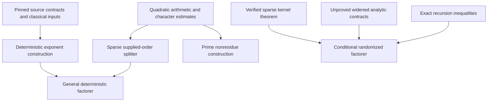

# Claim and proof-status register

Updated 26 November 2026. A status describes the evidence in this repository. The complete algorithmic claims and the Lean-verified components have separate statuses below.

## Main claims

| ID | Claim | Evidence supplied | Remaining qualification |
|---|---|---|---|
| D | Deterministic factoring in $\exp(O_\varepsilon((\log N)^{2/3+\varepsilon}))$ | Full replacement-schedule manuscript, stated imported algebraic contracts, analytic transfer argument, exact parameter checks | Written mathematical proof, subject to independent review; no endpoint $L_N[2/3,c]$ claim |
| S | Supplied-order splitting in $\exp(O(\sqrt{L\log L}))\operatorname{len}(M)L^{O(1)}$ | Sparse Gram proof, ramification treatment, exact enumeration and uniform character-sum appendix | Requires the supplied even multiple $M$; full implementation is not included |
| Q | Prime quadratic nonresidue construction in $L_p[1/2,O(1)]$ | Separate prime-input manuscript with the shared technical appendix included | Input primality is part of the problem; full implementation is not included |
| R | Randomized factoring in time $L_N[1/3,91.4]$ and workspace $L_N[1/3,19]$ | Conditional theorem, explicit contracts, sparse-kernel proof, exact recursion inequalities | **Conditional:** written QRH-based C1 assembly; full formal transfer and C2–C5 remain open |
| K | Sparse verified kernel construction over characteristic two | Algebraic proof, preconditioning and reconstruction argument, deterministic finite-field checks | This is a subroutine theorem; it does not alone establish R |
| C | Mixed-sign quadratic relation-chain success probability $>(1/2)$ | Written proof, Lean-certified finite-uniform success bound and arithmetic budget, executable routine, exhaustive small examples including repeated prime factors | Promise includes distinct hidden primes with opposite quadratic behavior and a suitable even $M$ |

The five manuscripts are [indexed here](../manuscripts/README.md). The sparse-kernel result K is part of the randomized manuscript, rather than a sixth nominal factoring algorithm.

## Dependencies

The general deterministic bound can use the slower pinned splitter and still attain its stated exponent. The sparse splitter is an independent improvement to the promised-input problem; it is not a hidden prerequisite for the $2/3+\varepsilon$ optimization.

## What the computations establish

The Python suite uses exact integers and rational numbers. It verifies the affine parameter inequalities, repaired recursion margins, local ramified Gram identities, and finite exhaustive counts. The JavaScript suite uses exact arithmetic in a small binary extension field and a fixed pseudorandom seed to check the sparse projection and blind-sign identities. It is a deterministic regression suite, not a statistical claim about all instances.

The committed expected outputs make the performed checks explicit. They do not certify smooth-number asymptotics, analytic continuation, zero-density estimates, or the existence of an effective threshold. Those require the manuscript proofs.

## Source and formal-proof status

The Google papers are fixed at commit `4a7bc8ab0bc770e71a259b7966c500496b99010a`; their exact PDF Git blob hashes are in [the lock file](../references/sources.lock.json). Their READMEs say that Lean formalizations have been completed and will be released in a companion submission. This repository has not obtained or checked those upstream formal artifacts.

This repository now has its own [Lean component formalization](../lean/README.md), compiled with Lean 4.19.0 and a pinned mathlib revision. A separate [analytic target](../lean-analytic/README.md) now certifies the classical strong PNT for Chebyshev theta and the eventual dyadic prime count, using pinned PNT+ and Lean 4.36.0. Growing-modulus equidistribution and effective finite thresholds are not thereby established. The arithmetic project's scope is:

| Manuscript component | Lean evidence | Still outside the formalization |
|---|---|---|
| D: deterministic schedule and saturation | All 19 inequalities; rational parameter choice; exact density-to-index guard and common order-multiple construction from verified modular powers; finite adaptive peeling invariant; conditional exponential-cost transfer; Dirichlet unit lattice and localized modular evaluation, two-field cancellation, prefix Parseval | Uniform smoothness and progression estimates; analytic row-loss estimates; construction and height bounds of number-field certificates; source contracts; full algorithm, bit-cost model, and actual cost hypotheses |
| S/Q: sparse Gram argument | Explicit split/inert/ramified local coefficient matrices and PSD domination; triangle-sign rank-one representation; Schur products and finite averaging; coprime smooth-product count, affine quadratic-character sum identity, executable scalar scan with both Euler-sign discrepancy success cases | Realization as quadratic ideal-character coefficients; compatible character and number-field constructions; enumeration complexity, analytic bounds, and algorithmic termination |
| R: repaired recursion | Universal path maxima, rational margins, exact subexponential scale contraction, and finite-threshold time/workspace recurrences with coefficients 91.4 and 19; uniform group and kernel-projection fibres; verified Krylov correction from an annihilating recurrence | Establishing the algorithm's recurrence and initial bounds; preconditioner rank probability and efficient recurrence discovery; widened analytic and probability contracts |
| C: quadratic relation chain | Executable odd-part decomposition and supplied-M splitter; proper-divisor soundness; exact finite-uniform success bound (p+3)/(2p)>1/2; abstract ring-multiplication and gcd operation budgets | Bit-operation implementation model, actual sampling/repeated-trial analysis, and additional manuscript corollaries (one-shot and selected-section claims); construction of a suitable supplied M and b is not assumed solved |
| Square-root extraction | A supplied nontrivial square congruence yields a proper gcd factor, with no oddness or invertibility assumption | Producing the congruence and proving its probability or cost |

The compiled axiom audit covers persistent logical declarations and permits only `propext`, `Classical.choice`, and `Quot.sound`. The project proofs use neither `sorry` nor `native_decide`. All mathematical examples are named theorems so that their proof dependencies remain auditable. These component proofs do not certify the complete complexity bounds in the main table. For K, equal-size fibres and correction from a supplied Krylov recurrence are now formalized; the rank/preconditioning and efficient recurrence-discovery arguments remain written proofs with finite computational checks. See the [second build receipt](../verification/lean/continuation.md) and [library-reuse receipt](../verification/lean/library-reuse.md).

Source pinning prevents a version mismatch. Hash verification proves identity of bytes, not correctness of a theorem. Ordinary mathematical dependencies are stated in the manuscripts so an auditor can assess them directly.

## Quasi-RH and next-stage checkpoint

The [quasi-RH audit](quasi_rh_audit.md) compares the actual OpenAI/math statements to the comparator targets and records independent default-kernel comparator acceptance. The [pinned Lean 4.34.1 import and adapters](../lean-qrh/README.md) are a new, separate integration target; two fresh project source builds and the seven-root axiom audit passed. The Lean 4.19 aggregate audit now covers all 277 named source theorems in 39 modules (run 45851754483). The exact pinned upstream RellichKondrachov patch fixed the earlier compatibility errors. The separate PNT+ receipt is unchanged.

A [written conditional consequence](quasi_rh_witnesses.md) of the Dirichlet and zeta seven-eighths zero-free theorem is a uniform prime detecting any nonprincipal Dirichlet character modulo \(q\), of size \(O_\varepsilon((\log(q+2))^{8+\varepsilon})\). Combined with the existing scalar splitting argument, it yields a route to polynomial-bit-time supplied-order splitting and prime nonresidue construction. The analytic argument and full bit-cost transfer are not yet Lean-certified, and a common order multiple is still required for splitting.

The five newly promoted Lean modules (binary arithmetic, Euler decay, unit-lattice clearing, modular remainder/multiplication and ordered prime-tuple moments) have strict compilation and named dependency evidence. See the [continuation receipt](../verification/lean/qrh-continuation.md). The new [weighted AP proof](qrh_weighted_progressions.md) proves the enlarged two-sided weighted progression estimate conditional on QRH; the [rough/bad-child continuation](weighted_rough_bad_child.md) also gives the local-limit density and tuned-scale comparability, rough and bad-child estimates, and proves the actual source's exceptional sets empty under QRH. These analytic arguments are written proofs, not Lean-verified endpoint theorems. The [new verification receipt](../verification/lean/reconstruction-readiness.md) records strict proofs of determinant bounds, actual digit-list modular exponentiation and gcd with cell-cost bounds, finite saddle calculus, and finite readiness propagation and normalization. Written proofs now treat the [uniform squarefree saddle expansion](deterministic_saddle_proof.md), [effective certificate reconstruction](effective_number_field_recovery.md) under the stated valuation and lattice hypotheses, [enlarged fibre coupling](randomized_fibre_coupling.md), and [conditional local moments](randomized_local_moments.md) under the identified analytic/classical inputs. The [latest aggregate verification receipt](../verification/lean/progression-readiness.md) adds rational recovery, finite saddle decay, actual power-basis field norms with the nonmonic correction, and the normalized two-prefix bound. The [deterministic squarefree progression argument](qrh_deterministic_progressions.md), [rational-root smoothing](randomized_rational_root_smoothing.md) and [setup/global readiness assembly](randomized_setup_readiness.md) are now written under the stated QRH and classical/analytic hypotheses. Full formal analytic arguments, simple-root ideal/valuation realization, Gram transfer, actual sampler and tree certification, C2–C5 including square certification, and complete bit-machine implementation remain open. The [fixed completion register](lean_completion.md) separates all proof packages.

## Claims deliberately left open

There is no completed proof here of an unconditional randomized $91.4/19$ factorer, a general deterministic $L_N[1/2,c]$ factorer, or a general classical factorer with first $L$-parameter below $1/3$. There is no benchmark showing practical superiority over GNFS. There is no completed end-to-end implementation of the asymptotic constructions.

The retained-construction notes also record failures and restricted results. Their presence in the archive must not be read as endorsement of every earlier candidate statement. See [errata](errata.md) and [provenance](../provenance/README.md).

See the [external int-fac comparison](int_fac_comparison.md) for the stronger full-Dirichlet-GRH deterministic endpoint, its reported verification, and the remaining differences from our randomized and independent constructions.

## New independent research beyond the two-thirds scale

[Monic polynomial marks](monic_polynomial_mark_factorer.md) gives a proved algebraic construction of monic totally real fields with a common modular root and asymmetric target-prime splitting, a polynomial-cost extraction theorem under explicit rank conditions, and a reduction of deterministic exp(O((log N)^(1/2+epsilon))) factoring to the open (COV) hypothesis. This replaces random polynomial-pair concentration by an averaged one-mark covariance bound for smooth resultants. It also proves an obstruction to a termwise CRT proof for complete prime-ideal factorizations. [Paired units](paired_unit_construction.md) gives d-O(d/sqrt(log n)) independent paired unit relations, but not full unit rank or a target-ideal relation. The finite experiment checks actual resultant values, valuation rank, modular exponent and gcd. The new half-scale bound is conditional, not an independently proved general factoring bound. No new Lean milestone is counted for it.

### Targeted half-scale checkpoint

The [exact target criterion and large-prime elimination](targeted_half_scale_search.md) replace the global covariance requirement by one lattice membership test, permit nonsquarefree norms, and establish a worst-case L_N[1/2,O(1)] **certificate search**. This is not a general factoring bound. The [ramified-target construction](ramified_target_construction.md) proves the initial ideal valuation equation for every target and supplies d-O(d/sqrt(log n)) shared unit directions (up to the stated additive rank offset). The specified marks alone provably cannot cancel the target log vector. Uniform success of the enlarged search remains open. No additional complete Lean milestone is counted; the priority is first to prove the half-scale bound, not to advertise another conditional one-third construction.

### Exact relation refinement and obstruction

The [large-order obstruction](half_scale_unit_rank_obstruction.md)
proves that on a density-one subset of balanced prime pairs all
polynomially bounded targets have exponential order; hence a
polynomial-bit-height certificate needs joint valuation/log rank
Omega(n/log n), and ordinary polynomial-log-height shared units
cannot span the target for our degree regimes. The [full-degree
factor-refinement search](full_degree_factor_refinement.md) uses
Ge's unconditional ideal-refinement theorem to avoid factoring
norms and all bad-prime restrictions, including at the ramified
prime. A reduced-degree construction permits a full-degree mark
box at the actual L_N[1/2,O(1)] search cost. Its prototype was
checked on two finite fixtures; no uniform successful-coverage
proof is supplied. The earlier full-rank COV and direct short-unit
strategies must not be assumed to supply the missing relations.

### Scalar-free target coverage audit

[Scalar-free extraction and the common-order obstruction](scalar_free_target_coverage.md) gives a polynomial-cost normalized target decision that annihilates every diagonal rational constant. On almost all balanced inputs the normalized finite-valuation rank of any successful polynomial-bit-height subfamily is Omega(n/log n). We prove that arbitrarily large polynomial rank can be contributed by private-prime columns without implying target membership, and characterize the prescribed unit's exact coset order via the gluing ring. Direct common-lattice Minkowski bounds retain a cofactor of exponential size. The new finite fixtures check the positive and negative normalized relations and the exact gluing order. Uniform success at some separating prime is still open; no unconditional half-scale general factorer or new Lean milestone is claimed.

### Forced coupled relations and one-field rank-one target

[One-field rank-one coverage](one_field_rank_one_coverage.md) constructs polynomial-bit-height marks with actual finite-valuation rank and independent congruence-unit rank Omega(n/log n), without singleton rows. A separate monic totally real field construction gives a full explicit log-unit basis with modular images ell^(-j); the known congruence units span all but one dimension. The exact half-scale search now tests a single scalar functional on a one-field valuation kernel. A standard-library fixture generates and certifies a 91-mark relation for N=77 with directed rational log intervals, giving exponent 4129380 and factor 11. Uniform transverse-unit coverage remains open; the finite success and the explicit unit span do not establish it. No new Lean milestone is claimed.

### Quadratic exact extraction and adverse-parameter obstruction

[2-adic rank-one extraction](padic_rank_one_extraction.md) recovers the exact rational unit coordinate using binary modular powering and lifting, with a proved polynomial compact-input bit bound. A first-derivative row modulo the field constant gives an integer-only sufficient test for nontriviality in degree two. The norm-gap and private-prime restrictions explain why smooth values remain necessary for the fixed bounded linear family, and short torsion identities are excluded by coefficient divisibility. The [adverse-parameter theorem](adversarial_rank_one_parameter.md) proves that for every predetermined bounded constant-one polynomial family on a sufficiently large balanced input one can construct a valid (possibly much larger) C for which the entire valuation-kernel image is trivial. Its proof uses gcd-free polynomial factors and pairwise resultants, without factoring the norms. This is not a counterexample to canonical-C coverage or an adaptive search. The finite 2-adic experiment reproduces the exact order multiple 4129380 and factor 11 for N=77, with 70 additional signed-coordinate and 40100 norm-gap checks. The adverse-field fixture certifies all 17 nonexceptional private supports. Uniform half-scale success remains unproved; the fixed Lean milestone count is unchanged.

### Field-free positive relation coverage

[Prime-character moments and positive smooth relations](positive_smooth_relation_coverage.md) proves uniform positive-relation existence inside every half-subset of a dyadic prime band, with an arbitrary chosen prime appearing twice, using the already verified Dirichlet zero-free strip and exact small-product collision moments. The inverse-representative search costs L_N[1/2,O(1)] and an independent random first-half word succeeds with probability 1-o(1), uniformly even under adaptive sign-subset selection. The resulting exact rank driver gives a written uniform randomized half-scale factorer without a new smoothness hypothesis, and nonuniform deterministic half-scale factorization with subexponential advice. The **uniform deterministic first-half selection remains open**; the original field-based transverse-unit problem is not proved. No new Lean milestone is counted.

### Derandomization literature and workspace reduction

[The prime-word derandomization audit](prime_word_derandomization_audit.md) examines the verified L=RL=BPL result, the 26 November Targeted Samplers release, and recent branching-program/auxiliary-stack simulations. A uniform O(b)-workspace read-once prefix verifier (or an appropriate bounded-access/oblivious-stack verifier) would now imply deterministic half-scale factoring by probability estimation and greedy bit fixing. Exact streaming product residue computation provably needs n-O(b) state bits. Generic dense-terminal-set hitting is also obstructed by support size, and the current near-uniform prime-word mechanism cannot scale to one third without a separate change. The QRH small-character-witness argument gives deterministic Miller tests; verified Dirichlet GRH and Bach's bound supply an explicit polynomial cutoff. No unconditional uniform half-scale selection theorem or new Lean milestone is claimed.

### Common anchor and randomness-access audit

[Common-anchor relations](common_anchor_derandomization.md) use the full-band collision moment to bound the relative support complement by B^(-36). One residue and all its prime-power translates give a nonsingular signed relation matrix when T>L, yielding a common exponent. The uniform randomized half-scale algorithm now uses one n-bit candidate per trial, and the nonuniform deterministic half-scale result needs only polynomial advice. An exact theoretical O(b)-workspace verifier with reusable read-only anchor bits uses uniform division/iterated multiplication and small-prime CRT equality. This is not a fresh-randomness BPL or constant-visit/oblivious-stack implementation. A bounded-access exact joint-congruence obstruction and a rare-event one-pass fingerprint clarify the remaining gap. Uniform deterministic selection is still unproved; the one-third investigation remains deferred and the fixed Lean completion register is unchanged.

### Disjoint narrow bands and streaming atoms

[The narrow-band continuation](narrow_band_streaming_atoms.md) proves that products of one prime from each of L disjoint narrow intervals still cover all but a B^(-34) fraction of unit residues. Exact lift membership becomes a depth-three OR-AND-OR of divisibility tests, with no product-equality or prime-power tests. A truncated quotient representative makes each atom exactly read-once in O(b) workspace; any constant number of atoms admits an exact conditional-count DP in half-scale time. Independent anchors per row suffice by taking T=2L+1. A constant-degree positive lower polynomial in the atoms would give deterministic bit fixing, but a generic OR-of-AND low-degree method is obstructed by an exact moment-matching construction. The actual arithmetic composition/hitting problem remains open. The exact finite checks are recorded in the note; no new Lean milestone is counted.

### Shared AP exact counting and partial relations

[The AP/lattice continuation](ap_lattice_conditional_counting.md) combines arbitrarily many specified prime conditions per multiplier by CRT, and counts exact prefix-conditioned anchors or partial product pairs by Euclidean floor sums. It proves uniform partial-sieve counts across the common lift index, and constructs signed joint congruences with roughly k prescribed band-prime occurrences and residual cofactors bounded by sqrt(N)+1. Weighted rank extraction allows arbitrary smooth signed cofactors rather than rigid narrow-band products. The remaining problem is aggregation over the unspecified prime products, or a uniform deterministic smooth-cofactor selection. The written proof and finite exact tests do not establish uniform half-scale factoring. No new Lean milestone is counted.
