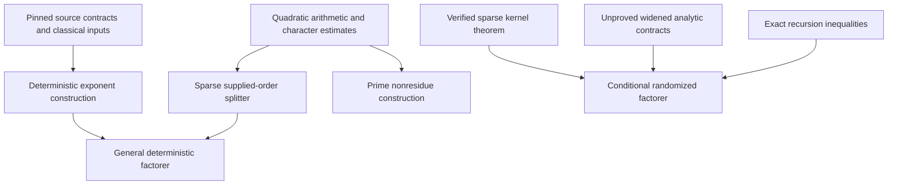

# Claim and proof-status register

Updated 26 November 2026. A status describes the evidence in this repository. The complete algorithmic claims and the Lean-verified components have separate statuses below.

## Main claims

| ID | Claim | Evidence supplied | Remaining qualification |
|---|---|---|---|
| D | Deterministic factoring in $\exp(O_\varepsilon((\log N)^{2/3+\varepsilon}))$ | Full replacement-schedule manuscript, stated imported algebraic contracts, analytic transfer argument, exact parameter checks | Written mathematical proof, subject to independent review; no endpoint $L_N[2/3,c]$ claim |
| S | Supplied-order splitting in $\exp(O(\sqrt{L\log L}))\operatorname{len}(M)L^{O(1)}$ | Sparse Gram proof, ramification treatment, exact enumeration and uniform character-sum appendix | Requires the supplied even multiple $M$; full implementation is not included |
| Q | Prime quadratic nonresidue construction in $L_p[1/2,O(1)]$ | Separate prime-input manuscript with the shared technical appendix included | Input primality is part of the problem; full implementation is not included |
| R | Randomized factoring in time $L_N[1/3,91.4]$ and workspace $L_N[1/3,19]$ | Conditional theorem, explicit contracts, sparse-kernel proof, exact recursion inequalities | **Conditional:** widened distribution, readiness, and square-certification obligations remain unproved |
| K | Sparse verified kernel construction over characteristic two | Algebraic proof, preconditioning and reconstruction argument, deterministic finite-field checks | This is a subroutine theorem; it does not alone establish R |
| C | Mixed-sign quadratic relation-chain success probability $>(1/2)$ | Written proof, Lean-certified finite-uniform success bound and arithmetic budget, executable routine, exhaustive small examples including repeated prime factors | Promise includes distinct hidden primes with opposite quadratic behavior and a suitable even $M$ |

The five manuscripts are [indexed here](../manuscripts/README.md). The sparse-kernel result K is part of the randomized manuscript, rather than a sixth nominal factoring algorithm.

## Dependencies

The general deterministic bound can use the slower pinned splitter and still attain its stated exponent. The sparse splitter is an independent improvement to the promised-input problem; it is not a hidden prerequisite for the $2/3+\varepsilon$ optimization.

## What the computations establish

The Python suite uses exact integers and rational numbers. It verifies the affine parameter inequalities, repaired recursion margins, local ramified Gram identities, and finite exhaustive counts. The JavaScript suite uses exact arithmetic in a small binary extension field and a fixed pseudorandom seed to check the sparse projection and blind-sign identities. It is a deterministic regression suite, not a statistical claim about all instances.

The committed expected outputs make the performed checks explicit. They do not certify smooth-number asymptotics, analytic continuation, zero-density estimates, or the existence of an effective threshold. Those require the manuscript proofs.

## Source and formal-proof status

The Google papers are fixed at commit `4a7bc8ab0bc770e71a259b7966c500496b99010a`; their exact PDF Git blob hashes are in [the lock file](../references/sources.lock.json). Their READMEs say that Lean formalizations have been completed and will be released in a companion submission. This repository has not obtained or checked those upstream formal artifacts.

This repository now has its own [Lean component formalization](../lean/README.md), compiled with Lean 4.19.0 and a pinned mathlib revision. Its scope is:

| Manuscript component | Lean evidence | Still outside the formalization |
|---|---|---|
| D: deterministic schedule and saturation | All 19 inequalities; rational parameter choice; exact density-to-index guard and common order-multiple construction from verified modular powers; conditional exponential-cost transfer | Smoothness and progression estimates; number-field certificate construction; source contracts; full algorithm, bit-cost model, and actual cost hypotheses |
| S/Q: sparse Gram argument | Explicit split/inert/ramified local coefficient matrices and PSD domination; triangle-sign rank-one representation; Schur products and finite averaging | Realization as quadratic ideal-character coefficients; compatible character and number-field constructions; enumeration complexity, analytic bounds, and algorithmic termination |
| R: repaired recursion | Universal path maxima, rational margins, exact subexponential scale contraction, and finite-threshold time/workspace recurrences with coefficients 91.4 and 19; uniform group and kernel-projection fibres | Establishing the algorithm's recurrence and initial bounds; preconditioner and kernel reconstruction; widened analytic and probability contracts |
| C: quadratic relation chain | Executable odd-part decomposition and supplied-M splitter; proper-divisor soundness; exact finite-uniform success bound (p+3)/(2p)>1/2; abstract ring-multiplication and gcd operation budgets | Bit-operation implementation model, actual sampling/repeated-trial analysis, and additional manuscript corollaries (one-shot and selected-section claims); construction of a suitable supplied M and b is not assumed solved |
| Square-root extraction | A supplied nontrivial square congruence yields a proper gcd factor, with no oddness or invertibility assumption | Producing the congruence and proving its probability or cost |

The compiled axiom audit covers persistent logical declarations and permits only `propext`, `Classical.choice`, and `Quot.sound`. The project proofs use neither `sorry` nor `native_decide`. All mathematical examples are named theorems so that their proof dependencies remain auditable. These component proofs do not certify the complete complexity bounds in the main table. For K, equal-size fibres of the kernel projection are now formalized; the rank/preconditioning and fast reconstruction arguments remain written proofs with finite computational checks. See the [second build receipt](../verification/lean/continuation.md).

Source pinning prevents a version mismatch. Hash verification proves identity of bytes, not correctness of a theorem. Ordinary mathematical dependencies are stated in the manuscripts so an auditor can assess them directly.

## Claims deliberately left open

There is no completed proof here of an unconditional randomized $91.4/19$ factorer, a general deterministic $L_N[1/2,c]$ factorer, or a general classical factorer with first $L$-parameter below $1/3$. There is no benchmark showing practical superiority over GNFS. There is no completed end-to-end implementation of the asymptotic constructions.

The retained-construction notes also record failures and restricted results. Their presence in the archive must not be read as endorsement of every earlier candidate statement. See [errata](errata.md) and [provenance](../provenance/README.md).
