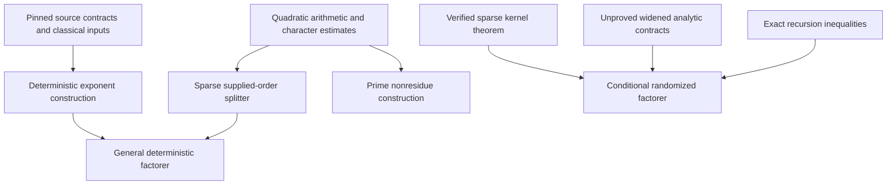

# Claim and proof-status register

Version: 0.1.0, 25 November 2026. A status describes the evidence in this repository, not acceptance by a journal or certification by a proof assistant.

## Main claims

| ID | Claim | Evidence supplied | Remaining qualification |
|---|---|---|---|
| D | Deterministic factoring in $\exp(O_\varepsilon((\log N)^{2/3+\varepsilon}))$ | Full replacement-schedule manuscript, stated imported algebraic contracts, analytic transfer argument, exact parameter checks | Written mathematical proof, subject to independent review; no endpoint $L_N[2/3,c]$ claim |
| S | Supplied-order splitting in $\exp(O(\sqrt{L\log L}))\operatorname{len}(M)L^{O(1)}$ | Sparse Gram proof, ramification treatment, exact enumeration and uniform character-sum appendix | Requires the supplied even multiple $M$; full implementation is not included |
| Q | Prime quadratic nonresidue construction in $L_p[1/2,O(1)]$ | Separate prime-input manuscript with the shared technical appendix included | Input primality is part of the problem; full implementation is not included |
| R | Randomized factoring in time $L_N[1/3,91.4]$ and workspace $L_N[1/3,19]$ | Conditional theorem, explicit contracts, sparse-kernel proof, exact recursion inequalities | **Conditional:** widened distribution, readiness, and square-certification obligations remain unproved |
| K | Sparse verified kernel construction over characteristic two | Algebraic proof, preconditioning and reconstruction argument, deterministic finite-field checks | This is a subroutine theorem; it does not alone establish R |
| C | Mixed-sign quadratic relation-chain success probability $>(1/2)$ | Local counting proof, executable routine, exhaustive small examples including repeated prime factors | Promise includes distinct hidden primes with opposite quadratic behavior and a suitable even $M$ |

The five manuscripts are [indexed here](../manuscripts/README.md). The sparse-kernel result K is part of the randomized manuscript, rather than a sixth nominal factoring algorithm.

## Dependencies

The general deterministic bound can use the slower pinned splitter and still attain its stated exponent. The sparse splitter is an independent improvement to the promised-input problem; it is not a hidden prerequisite for the $2/3+\varepsilon$ optimization.

## What the computations establish

The Python suite uses exact integers and rational numbers. It verifies the affine parameter inequalities, repaired recursion margins, local ramified Gram identities, and finite exhaustive counts. The JavaScript suite uses exact arithmetic in a small binary extension field and a fixed pseudorandom seed to check the sparse projection and blind-sign identities. It is a deterministic regression suite, not a statistical claim about all instances.

The committed expected outputs make the performed checks explicit. They do not certify smooth-number asymptotics, analytic continuation, zero-density estimates, or the existence of an effective threshold. Those require the manuscript proofs.

## Source and formal-proof status

The Google papers are fixed at commit `4a7bc8ab0bc770e71a259b7966c500496b99010a`; their exact PDF Git blob hashes are in [the lock file](../references/sources.lock.json). Their READMEs say that Lean formalizations have been completed and will be released in a companion submission. This repository has not obtained or checked those formal artifacts and makes no claim that the manuscripts here are Lean-verified.

Source pinning prevents a version mismatch. Hash verification proves identity of bytes, not correctness of a theorem. Ordinary mathematical dependencies are stated in the manuscripts so an auditor can assess them directly.

## Claims deliberately left open

There is no completed proof here of an unconditional randomized $91.4/19$ factorer, a general deterministic $L_N[1/2,c]$ factorer, or a general classical factorer with first $L$-parameter below $1/3$. There is no benchmark showing practical superiority over GNFS. There is no completed end-to-end implementation of the asymptotic constructions.

The retained-construction notes also record failures and restricted results. Their presence in the archive must not be read as endorsement of every earlier candidate statement. See [errata](errata.md) and [provenance](../provenance/README.md).
