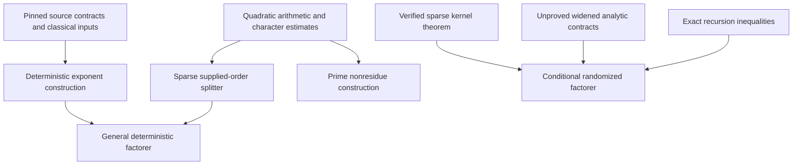

# Claim and proof-status register

Updated 27 November 2026. A status describes the evidence in this repository. The complete algorithmic claims and the Lean-verified components have separate statuses below.

## Main claims

| ID | Claim | Evidence supplied | Remaining qualification |
|---|---|---|---|
| D | Deterministic factoring in $\exp(O_\varepsilon((\log N)^{2/3+\varepsilon}))$ | Full replacement-schedule manuscript, stated imported algebraic contracts, analytic transfer argument, exact parameter checks | Written mathematical proof, subject to independent review; no endpoint $L_N[2/3,c]$ claim |
| S | Supplied-order splitting in $\exp(O(\sqrt{L\log L}))\operatorname{len}(M)L^{O(1)}$ | Sparse Gram proof, ramification treatment, exact enumeration and uniform character-sum appendix | Requires the supplied even multiple $M$; full implementation is not included |
| Q | Prime quadratic nonresidue construction in $L_p[1/2,O(1)]$ | Separate prime-input manuscript with the shared technical appendix included | Input primality is part of the problem; full implementation is not included |
| R | Randomized factoring in time $L_N[1/3,91.4]$ and workspace $L_N[1/3,19]$ | Conditional theorem, explicit contracts, sparse-kernel proof, exact recursion inequalities | **Conditional:** written QRH-based C1 assembly; full formal transfer and C2–C5 remain open |
| U100 | Randomized complete factorization in expected $L_N[1/3,100]$ | [Written changed-range ordinary-concentration proof](keybreak_u100_proof.md), classical analytic imports, source finite lemmas, exact recursive margins | No GRH or new conjectural covariance hypothesis in the written argument; independent review, formal verification and full implementation remain open |
| U40 | Randomized complete factorization in expected $L_N[1/3,40]$ | [Written weighted semismooth-concentration and linear-incidence proof](keybreak_u40_proof.md), with U100's analytic transfer and exact cost margins | No GRH or additional semismooth conjecture in the written argument; source finite lemmas and published analytic results are imports; not an independently certified record; no workspace constant asserted |
| U14.1 | Randomized complete factorization in expected $L_N[1/3,14.1]$ | [Optimized proof](keybreak_u142_proof.md#8-tighten-the-same-schedule-to-141), [U40 critical audit](keybreak_u40_critical_audit.md), exact range and recursive guards | Written unconditional-route proof by reuse of U40 and source finite/analytic imports; independent review and formal verification remain open; no new workspace bound |
| G2.96 | Randomized complete factorization in expected $L_N[1/3,2.96]$ | [Same-geometry GRH cost transfer](keybreak_grh_constants.md#1-recognition-slack-and-the-same-analytic-schedule-296), exact cap inequalities | Conditional on Dirichlet GRH and source arithmetic/certificate estimates; changed-range 2.95 candidate remains separate |
| K | Sparse verified kernel construction over characteristic two | Algebraic proof, preconditioning and reconstruction argument, deterministic finite-field checks | This is a subroutine theorem; it does not alone establish R |
| C | Mixed-sign quadratic relation-chain success probability $>(1/2)$ | Written proof, Lean-certified finite-uniform success bound and arithmetic budget, executable routine, exhaustive small examples including repeated prime factors | Promise includes distinct hidden primes with opposite quadratic behavior and a suitable even $M$ |

The five manuscripts are [indexed here](../manuscripts/README.md). The sparse-kernel result K is part of the randomized manuscript, rather than a sixth nominal factoring algorithm.

## Dependencies

The general deterministic bound can use the slower pinned splitter and still attain its stated exponent. The sparse splitter is an independent improvement to the promised-input problem; it is not a hidden prerequisite for the $2/3+\varepsilon$ optimization.

## What the computations establish

The Python suite uses exact integers and rational numbers. It verifies the affine parameter inequalities, repaired recursion margins, local ramified Gram identities, and finite exhaustive counts. The JavaScript suite uses exact arithmetic in a small binary extension field and a fixed pseudorandom seed to check the sparse projection and blind-sign identities. It is a deterministic regression suite, not a statistical claim about all instances.

The committed expected outputs make the performed checks explicit. They do not certify smooth-number asymptotics, analytic continuation, zero-density estimates, or the existence of an effective threshold. Those require the manuscript proofs.

## Source and formal-proof status

The Google papers are fixed at commit `4a7bc8ab0bc770e71a259b7966c500496b99010a`; their exact PDF Git blob hashes are in [the lock file](../references/sources.lock.json). Their READMEs say that Lean formalizations have been completed and will be released in a companion submission. This repository has not obtained or checked those upstream formal artifacts.

This repository now has its own [Lean component formalization](../lean/README.md), compiled with Lean 4.19.0 and a pinned mathlib revision. A separate [analytic target](../lean-analytic/README.md) now certifies the classical strong PNT for Chebyshev theta and the eventual dyadic prime count, using pinned PNT+ and Lean 4.36.0. Growing-modulus equidistribution and effective finite thresholds are not thereby established. The arithmetic project's scope is:

| Manuscript component | Lean evidence | Still outside the formalization |
|---|---|---|
| D: deterministic schedule and saturation | All 19 inequalities; rational parameter choice; exact density-to-index guard and common order-multiple construction from verified modular powers; finite adaptive peeling invariant; conditional exponential-cost transfer; Dirichlet unit lattice and localized modular evaluation, two-field cancellation, prefix Parseval | Uniform smoothness and progression estimates; analytic row-loss estimates; construction and height bounds of number-field certificates; source contracts; full algorithm, bit-cost model, and actual cost hypotheses |
| S/Q: sparse Gram argument | Explicit split/inert/ramified local coefficient matrices and PSD domination; triangle-sign rank-one representation; Schur products and finite averaging; coprime smooth-product count, affine quadratic-character sum identity, executable scalar scan with both Euler-sign discrepancy success cases | Realization as quadratic ideal-character coefficients; compatible character and number-field constructions; enumeration complexity, analytic bounds, and algorithmic termination |
| R: repaired recursion | Universal path maxima, rational margins, exact subexponential scale contraction, and finite-threshold time/workspace recurrences with coefficients 91.4 and 19; uniform group and kernel-projection fibres; verified Krylov correction from an annihilating recurrence | Establishing the algorithm's recurrence and initial bounds; preconditioner rank probability and efficient recurrence discovery; widened analytic and probability contracts |
| C: quadratic relation chain | Executable odd-part decomposition and supplied-M splitter; proper-divisor soundness; exact finite-uniform success bound (p+3)/(2p)>1/2; abstract ring-multiplication and gcd operation budgets | Bit-operation implementation model, actual sampling/repeated-trial analysis, and additional manuscript corollaries (one-shot and selected-section claims); construction of a suitable supplied M and b is not assumed solved |
| Square-root extraction | A supplied nontrivial square congruence yields a proper gcd factor, with no oddness or invertibility assumption | Producing the congruence and proving its probability or cost |

The compiled axiom audit covers persistent logical declarations and permits only `propext`, `Classical.choice`, and `Quot.sound`. The project proofs use neither `sorry` nor `native_decide`. All mathematical examples are named theorems so that their proof dependencies remain auditable. These component proofs do not certify the complete complexity bounds in the main table. For K, equal-size fibres and correction from a supplied Krylov recurrence are now formalized; the rank/preconditioning and efficient recurrence-discovery arguments remain written proofs with finite computational checks. See the [second build receipt](../verification/lean/continuation.md) and [library-reuse receipt](../verification/lean/library-reuse.md).

Source pinning prevents a version mismatch. Hash verification proves identity of bytes, not correctness of a theorem. Ordinary mathematical dependencies are stated in the manuscripts so an auditor can assess them directly.

## Quasi-RH and next-stage checkpoint

The [quasi-RH audit](quasi_rh_audit.md) compares the actual OpenAI/math statements to the comparator targets and records independent default-kernel comparator acceptance. The [pinned Lean 4.34.1 import and adapters](../lean-qrh/README.md) are a new, separate integration target; two fresh project source builds and the seven-root axiom audit passed. The Lean 4.19 aggregate audit now covers all 277 named source theorems in 39 modules (run 45851754483). The exact pinned upstream RellichKondrachov patch fixed the earlier compatibility errors. The separate PNT+ receipt is unchanged.

A [written conditional consequence](quasi_rh_witnesses.md) of the Dirichlet and zeta seven-eighths zero-free theorem is a uniform prime detecting any nonprincipal Dirichlet character modulo \(q\), of size \(O_\varepsilon((\log(q+2))^{8+\varepsilon})\). Combined with the existing scalar splitting argument, it yields a route to polynomial-bit-time supplied-order splitting and prime nonresidue construction. The analytic argument and full bit-cost transfer are not yet Lean-certified, and a common order multiple is still required for splitting.

The five newly promoted Lean modules (binary arithmetic, Euler decay, unit-lattice clearing, modular remainder/multiplication and ordered prime-tuple moments) have strict compilation and named dependency evidence. See the [continuation receipt](../verification/lean/qrh-continuation.md). The new [weighted AP proof](qrh_weighted_progressions.md) proves the enlarged two-sided weighted progression estimate conditional on QRH; the [rough/bad-child continuation](weighted_rough_bad_child.md) also gives the local-limit density and tuned-scale comparability, rough and bad-child estimates, and proves the actual source's exceptional sets empty under QRH. These analytic arguments are written proofs, not Lean-verified endpoint theorems. The [new verification receipt](../verification/lean/reconstruction-readiness.md) records strict proofs of determinant bounds, actual digit-list modular exponentiation and gcd with cell-cost bounds, finite saddle calculus, and finite readiness propagation and normalization. Written proofs now treat the [uniform squarefree saddle expansion](deterministic_saddle_proof.md), [effective certificate reconstruction](effective_number_field_recovery.md) under the stated valuation and lattice hypotheses, [enlarged fibre coupling](randomized_fibre_coupling.md), and [conditional local moments](randomized_local_moments.md) under the identified analytic/classical inputs. The [latest aggregate verification receipt](../verification/lean/progression-readiness.md) adds rational recovery, finite saddle decay, actual power-basis field norms with the nonmonic correction, and the normalized two-prefix bound. The [deterministic squarefree progression argument](qrh_deterministic_progressions.md), [rational-root smoothing](randomized_rational_root_smoothing.md) and [setup/global readiness assembly](randomized_setup_readiness.md) are now written under the stated QRH and classical/analytic hypotheses. Full formal analytic arguments, simple-root ideal/valuation realization, Gram transfer, actual sampler and tree certification, C2–C5 including square certification, and complete bit-machine implementation remain open. The [fixed completion register](lean_completion.md) separates all proof packages.

## Claims deliberately left open

There is no completed proof here of an unconditional randomized $91.4/19$ factorer, a general deterministic $L_N[1/2,c]$ factorer, or a general classical factorer with first $L$-parameter below $1/3$. There is no benchmark showing practical superiority over GNFS. There is no completed end-to-end implementation of the asymptotic constructions.

The retained-construction notes also record failures and restricted results. Their presence in the archive must not be read as endorsement of every earlier candidate statement. See [errata](errata.md) and [provenance](../provenance/README.md).

See the [external int-fac comparison](int_fac_comparison.md) for the stronger full-Dirichlet-GRH deterministic endpoint, its reported verification, and the remaining differences from our randomized and independent constructions.

## New independent research beyond the two-thirds scale

[Monic polynomial marks](monic_polynomial_mark_factorer.md) gives a proved algebraic construction of monic totally real fields with a common modular root and asymmetric target-prime splitting, a polynomial-cost extraction theorem under explicit rank conditions, and a reduction of deterministic exp(O((log N)^(1/2+epsilon))) factoring to the open (COV) hypothesis. This replaces random polynomial-pair concentration by an averaged one-mark covariance bound for smooth resultants. It also proves an obstruction to a termwise CRT proof for complete prime-ideal factorizations. [Paired units](paired_unit_construction.md) gives d-O(d/sqrt(log n)) independent paired unit relations, but not full unit rank or a target-ideal relation. The finite experiment checks actual resultant values, valuation rank, modular exponent and gcd. The new half-scale bound is conditional, not an independently proved general factoring bound. No new Lean milestone is counted for it.

### Targeted half-scale checkpoint

The [exact target criterion and large-prime elimination](targeted_half_scale_search.md) replace the global covariance requirement by one lattice membership test, permit nonsquarefree norms, and establish a worst-case L_N[1/2,O(1)] **certificate search**. This is not a general factoring bound. The [ramified-target construction](ramified_target_construction.md) proves the initial ideal valuation equation for every target and supplies d-O(d/sqrt(log n)) shared unit directions (up to the stated additive rank offset). The specified marks alone provably cannot cancel the target log vector. Uniform success of the enlarged search remains open. No additional complete Lean milestone is counted; the priority is first to prove the half-scale bound, not to advertise another conditional one-third construction.

### Exact relation refinement and obstruction

The [large-order obstruction](half_scale_unit_rank_obstruction.md)
proves that on a density-one subset of balanced prime pairs all
polynomially bounded targets have exponential order; hence a
polynomial-bit-height certificate needs joint valuation/log rank
Omega(n/log n), and ordinary polynomial-log-height shared units
cannot span the target for our degree regimes. The [full-degree
factor-refinement search](full_degree_factor_refinement.md) uses
Ge's unconditional ideal-refinement theorem to avoid factoring
norms and all bad-prime restrictions, including at the ramified
prime. A reduced-degree construction permits a full-degree mark
box at the actual L_N[1/2,O(1)] search cost. Its prototype was
checked on two finite fixtures; no uniform successful-coverage
proof is supplied. The earlier full-rank COV and direct short-unit
strategies must not be assumed to supply the missing relations.

### Scalar-free target coverage audit

[Scalar-free extraction and the common-order obstruction](scalar_free_target_coverage.md) gives a polynomial-cost normalized target decision that annihilates every diagonal rational constant. On almost all balanced inputs the normalized finite-valuation rank of any successful polynomial-bit-height subfamily is Omega(n/log n). We prove that arbitrarily large polynomial rank can be contributed by private-prime columns without implying target membership, and characterize the prescribed unit's exact coset order via the gluing ring. Direct common-lattice Minkowski bounds retain a cofactor of exponential size. The new finite fixtures check the positive and negative normalized relations and the exact gluing order. Uniform success at some separating prime is still open; no unconditional half-scale general factorer or new Lean milestone is claimed.

### Forced coupled relations and one-field rank-one target

[One-field rank-one coverage](one_field_rank_one_coverage.md) constructs polynomial-bit-height marks with actual finite-valuation rank and independent congruence-unit rank Omega(n/log n), without singleton rows. A separate monic totally real field construction gives a full explicit log-unit basis with modular images ell^(-j); the known congruence units span all but one dimension. The exact half-scale search now tests a single scalar functional on a one-field valuation kernel. A standard-library fixture generates and certifies a 91-mark relation for N=77 with directed rational log intervals, giving exponent 4129380 and factor 11. Uniform transverse-unit coverage remains open; the finite success and the explicit unit span do not establish it. No new Lean milestone is claimed.

### Quadratic exact extraction and adverse-parameter obstruction

[2-adic rank-one extraction](padic_rank_one_extraction.md) recovers the exact rational unit coordinate using binary modular powering and lifting, with a proved polynomial compact-input bit bound. A first-derivative row modulo the field constant gives an integer-only sufficient test for nontriviality in degree two. The norm-gap and private-prime restrictions explain why smooth values remain necessary for the fixed bounded linear family, and short torsion identities are excluded by coefficient divisibility. The [adverse-parameter theorem](adversarial_rank_one_parameter.md) proves that for every predetermined bounded constant-one polynomial family on a sufficiently large balanced input one can construct a valid (possibly much larger) C for which the entire valuation-kernel image is trivial. Its proof uses gcd-free polynomial factors and pairwise resultants, without factoring the norms. This is not a counterexample to canonical-C coverage or an adaptive search. The finite 2-adic experiment reproduces the exact order multiple 4129380 and factor 11 for N=77, with 70 additional signed-coordinate and 40100 norm-gap checks. The adverse-field fixture certifies all 17 nonexceptional private supports. Uniform half-scale success remains unproved; the fixed Lean milestone count is unchanged.

### Field-free positive relation coverage

[Prime-character moments and positive smooth relations](positive_smooth_relation_coverage.md) proves uniform positive-relation existence inside every half-subset of a dyadic prime band, with an arbitrary chosen prime appearing twice, using the already verified Dirichlet zero-free strip and exact small-product collision moments. The inverse-representative search costs L_N[1/2,O(1)] and an independent random first-half word succeeds with probability 1-o(1), uniformly even under adaptive sign-subset selection. The resulting exact rank driver gives a written uniform randomized half-scale factorer without a new smoothness hypothesis, and nonuniform deterministic half-scale factorization with subexponential advice. The **uniform deterministic first-half selection remains open**; the original field-based transverse-unit problem is not proved. No new Lean milestone is counted.

### Derandomization literature and workspace reduction

[The prime-word derandomization audit](prime_word_derandomization_audit.md) examines the verified L=RL=BPL result, the 26 November Targeted Samplers release, and recent branching-program/auxiliary-stack simulations. A uniform O(b)-workspace read-once prefix verifier (or an appropriate bounded-access/oblivious-stack verifier) would now imply deterministic half-scale factoring by probability estimation and greedy bit fixing. Exact streaming product residue computation provably needs n-O(b) state bits. Generic dense-terminal-set hitting is also obstructed by support size, and the current near-uniform prime-word mechanism cannot scale to one third without a separate change. The QRH small-character-witness argument gives deterministic Miller tests; verified Dirichlet GRH and Bach's bound supply an explicit polynomial cutoff. No unconditional uniform half-scale selection theorem or new Lean milestone is claimed.

### Common anchor and randomness-access audit

[Common-anchor relations](common_anchor_derandomization.md) use the full-band collision moment to bound the relative support complement by B^(-36). One residue and all its prime-power translates give a nonsingular signed relation matrix when T>L, yielding a common exponent. The uniform randomized half-scale algorithm now uses one n-bit candidate per trial, and the nonuniform deterministic half-scale result needs only polynomial advice. An exact theoretical O(b)-workspace verifier with reusable read-only anchor bits uses uniform division/iterated multiplication and small-prime CRT equality. This is not a fresh-randomness BPL or constant-visit/oblivious-stack implementation. A bounded-access exact joint-congruence obstruction and a rare-event one-pass fingerprint clarify the remaining gap. Uniform deterministic selection is still unproved; the one-third investigation remains deferred and the fixed Lean completion register is unchanged.

### Disjoint narrow bands and streaming atoms

[The narrow-band continuation](narrow_band_streaming_atoms.md) proves that products of one prime from each of L disjoint narrow intervals still cover all but a B^(-34) fraction of unit residues. Exact lift membership becomes a depth-three OR-AND-OR of divisibility tests, with no product-equality or prime-power tests. A truncated quotient representative makes each atom exactly read-once in O(b) workspace; any constant number of atoms admits an exact conditional-count DP in half-scale time. Independent anchors per row suffice by taking T=2L+1. A constant-degree positive lower polynomial in the atoms would give deterministic bit fixing, but a generic OR-of-AND low-degree method is obstructed by an exact moment-matching construction. The actual arithmetic composition/hitting problem remains open. The exact finite checks are recorded in the note; no new Lean milestone is counted.

### Shared AP exact counting and partial relations

[The AP/lattice continuation](ap_lattice_conditional_counting.md) combines arbitrarily many specified prime conditions per multiplier by CRT, and counts exact prefix-conditioned anchors or partial product pairs by Euclidean floor sums. It proves uniform partial-sieve counts across the common lift index, and constructs signed joint congruences with roughly k prescribed band-prime occurrences and residual cofactors bounded by sqrt(N)+1. Weighted rank extraction allows arbitrary smooth signed cofactors rather than rigid narrow-band products. The remaining problem is aggregation over the unspecified prime products, or a uniform deterministic smooth-cofactor selection. The written proof and finite exact tests do not establish uniform half-scale factoring. No new Lean milestone is counted.

### Primitive-ratio compressed aggregation and residual graph cancellation

[Primitive-ratio lattice aggregation](primitive_ratio_lattice_aggregation.md) enumerates all primitive unit points in a rectangular congruence lattice in polynomial(log N)*(1+XY/N) bit time, or finds a factor, including collinear skew lattices. After prescribing factors, this counts all unknown disjoint-band suffix tuples at determinant-scale area, rather than expanding them. The verified Dirichlet-strip input gives dense short-ratio coverage with an exact half-scale membership/count oracle. Large primes above 2XY/N occur at most once on either side; gcd-free refinement and positive weighted graph components give a necessary-and-sufficient cancellation test and compact power relations even without individual smooth pairs. An explicit collinear family disproves uniform short smooth-ratio coverage for arbitrary multipliers. Uniform selection at target powers or a two-ratio decomposition remains open. The finite graph and exact lattice checks are recorded in the note; no new Lean milestone is counted.

### Dyadic normalization and global cofactor pooling

[Power-shift balancing and pooled relations](power_shift_pooled_relations.md) proves that every unit multiplier has a dyadic shift with no nonzero vector in a square of radius floor(sqrt((N-1)/3)), and constructs an O(sqrt N) lattice basis in polynomial bit time. An explicit CRT completion finds primitive coefficient pairs under arbitrary primitive coordinate residues at subexponential moduli. Weighted rank remains valid after the dyadic correction. A global gcd-free basis and exact augmented rank difference characterize the small-base relation space of all collected ratios, even across distinct target primes. In a verified N=100160063 fixture all seven individual target spaces have rank zero but the pooled rank is seven, giving factor 10007; balanced shifts alone suffice. The remaining uniform rank-increase/cofactor-coverage theorem is open. No new Lean milestone is counted.

### Adaptive exponent separation: exact rank-or-residual dichotomy

[Adaptive rank-or-residual theorem](adaptive_rank_or_residual.md) uses compact recycling of previous residuals and an exact dual functional to choose target exponents so that every normalized row either increases pure base rank or adds an independent residual direction. The proof covers adaptive local prescriptions and dyadic shifts and gives polynomial bit bounds for a bounded number of attempts. The local experiments include failures: even deliberate shared residual prescriptions do not force a dependence; the previous broad pooled search can outperform this greedy variant. The remaining uniform bound on residual rank or constructive residual-span membership is open. No new Lean milestone is counted.

### Residual support accounting and complete 2-primary extraction

[Support budget and 2-saturation](support_budget_and_two_saturation.md) proves an exact factor-free residual-span membership oracle using maximal perfect-power roots of disjoint gcd-free bases, and a computable bound on cumulative residual rank from newly introduced prime-support mass. The uniform bound on that mass is still open. Elementary parity saturation and exact cyclic 2-group bit lifting extract all 2-primary information in the integer rational span of the full pooled matrix, including nonzero residual directions. A verified one-row fixture at N=10403 has zero pure rank but yields factor 101. The new support-aware all-shifts rule improves two previous finite fixtures; the negative results and the actual gcd versus rank exits are distinguished. No uniform half-scale success theorem or new Lean milestone is claimed.

### Prime-primary readout, common-order endpoint and batch-affine rank

[The primary pooling continuation](primary_pool_extraction.md) extends complete saturated-span readout to all processed prime-primary components. If no split occurs, their exact common cyclic order C divides p-1 for every prime divisor p of N. A proved explicit LLL small-root schedule gives deterministic half-scale splitting whenever C >= 2^(floor(n/4)-D b), with b at the half scale and D fixed, without balanced-input assumptions. The new batch-affine separation theorem makes any residual dependence with nonzero total new coefficient force pure rank progress, even when no individual residual lies in the old span. Exact tests include an odd-primary-only factor of 1333 and negative larger-batch and stalled-pool checks. Uniform coverage of these sufficient exits, or a subexponential cumulative residual bound, remains open. No new Lean milestone is counted.

### Factor-free squareclass pooling

[Square-target lattices and parity pooling](squareclass_ratio_pool.md) gives exact squareclass membership and incremental gcd refinement without factoring, balancing that preserves a known square root, and complete first-level kernel extraction with compression to independent squareclasses. A sparse-target theorem shows that two-ratio collisions alone cover at most N^{o(1)} multipliers at determinant-scale heights. Longer parity dependencies of 21 and 94 rows split both earlier difficult fixtures in new square-target searches. The remaining uniform nontrivial parity-dependency/odd-support coverage theorem is open; these finite results do not secure the half-scale deterministic endpoint. No new Lean milestone is counted.

### Character-lift obstruction and labelled short-ratio coverage

[Jacobi character-lift ratio coverage](character_lift_ratio_coverage.md) gives exact linear feasibility over Z/2^e: inconsistency yields a Jacobi-negative 2^e-torsion unit and factors when e<v2(N-1). For inputs where the Jacobi character has no 2^e-th character root, twisted prime moments and Hölder prove that almost every short-ratio fibre has two different labels, uniformly over arbitrary candidate lift assignments, for fixed e (or 2^(2e)=o(L)). The determinant-scale lattice oracle tests an individual fibre exactly; each differing-label collision cuts the candidate solution set or produces a split. This avoids residual-rank growth in that restricted randomized progress mechanism. Four finite exact runs split inputs at depths one through four. Uniform deterministic target selection and unrestricted input coverage remain open; no new general factoring bound or Lean milestone is claimed.

### Depth-independent character rigidity

[Depth-free character rigidity](depth_free_character_rigidity.md) proves that if more than half the powers of a label function approximate Dirichlet characters, their character approximations extend to a genuine homomorphism. This removes the M^2=o(L) limitation in the preceding Jacobi-labelled ratio coverage proof. A balanced ratio and its one-prime translate also give a uniform dense label-disagreement theorem for arbitrary primitive integer annihilators, without the Jacobi input restriction. Each successful query strictly increases ordinary rational relation rank, and the exact finite driver reaches full rank on five fixtures. Deterministic uniform target selection remains open; the existing randomized complexity and polynomial-advice result are not improved. No new Lean milestone is counted.

### 27 November: closure, linear advice, architecture barrier and descent

- [Closure and source intake](2026-11-27_source_intake_and_closure.md): the previous finite-group labelled-rank argument was audited and its label-storage and randomized-recursion wording clarified. The Shanghai PDF was not accessible, so only source metadata, reported claims, and precursor notes were reviewed. No source-proof validation.
- [Linear advice](linear_advice_half_scale.md): a proved elementary expander-walk transfer from the common-anchor analytic input reduces total advice to \(O(n)\) bits for all inputs of length at most \(n\). It is **nonuniform**, not a uniform deterministic half-scale theorem.
- [Volume–smoothness support bound](short_ratio_scale_barrier.md): unconditional counting theorem for arbitrary signed smooth rational certificates with bounded reduced height and a bounded shift menu; below half scale the direct dense-fibre architecture cannot retain its previous height/time parameters. No algorithm-independent lower bound.
- [Descent accounting](multilevel_descent_accounting.md): proved abstract incidence, restart and recursion lemmas, plus adaptive independent sealed-root exposure and CRT separation. No Shanghai arithmetic estimate has been established or transferred.
- [Exact finite checks](../verification/research/README.md#descent-accounting-height-and-linear-advice-checks): standalone Python script run locally, with its tested Git blob matched after commit. The full repository suite, PDFs and Lean artifacts were not rebuilt in this continuation. No new Lean milestone or upgraded general complexity exponent is counted.

Priority: uniform deterministic \(L_N[1/2,O(1)]\) via an arithmetic-specific hitter. In parallel, complete the arithmetic transfer for compressed growing descent and pursue a genuinely scale-changing randomized mechanism.

### 27 November: pinned KeyBreak source and proposed unconditional-route compression

- [Pinned-source audit](keybreak_source_audit.md): actual 144-page PDF supplied and SHA-256 pinned. The source claims \(L_N[1/3,10^{13}]\) unconditionally and \(L_N[1/3,2.97]\) under Dirichlet GRH; 1013 was a superscript transcription error. Attribution corrected to the KeyBreak Cryptanalysis Agent. Selected finite, algebraic, analytic and cost steps audited; complete independent validation remains open.
- [Compressed U](keybreak_unconditional_compression.md): proved small-value large-sieve extension, abstract linear bad-child propagation under specified incidence hypotheses, second-moment top-pool bound and exact parameter/recursion ledger. Proposed transfer extends C.3 to weighted semismooth counts and changes the source schedule. **Conditional on the transferred arithmetic and certificate inputs**, expected \(L_N[1/3,40]\), with no GRH assumed in the proposed arithmetic proof. The full analytic transfer is not yet independently verified or formalized; neither an unconditional new record nor a new Lean milestone is asserted.
- [Exact checks](../verification/research/README.md#keybreak-compressed-unconditional-route): matched local and committed script blobs, 18 finite symbolic bit-length schedules and 72,000 semismooth content identities, together with exact leading-constant margins. The main 91.4/19 conditional manuscript theorem and its workspace qualification remain unchanged.

### KeyBreak constant continuation

- [U100 fallback](keybreak_unconditional_fallback.md): retains the original ordinary C.3 and B.17 upper-moment/square-root transfer, using a revised ordinary moment order and cutoff schedule. Conditional expected \(L_N[1/3,100]\) with no GRH in the proposed arithmetic route. No new semismooth concentration requirement; changed-range source estimates remain to be verified. This is the preferred first U verification target before the more ambitious U40.
- [GRH constants](keybreak_grh_constants.md): 2.96 cost transfer at the original analytic geometry with smaller finite recognition/density slack; 2.95 changed-range conditional schedule with separately checked guard margins. Both assume the source estimates and Dirichlet GRH (and the stronger target needs the changed-range transfer). Neither is an independently certified full proof.
- [Exact checks](../verification/research/README.md#keybreak-fallback-and-grh-constants): three tested scripts in total, 54 symbolic schedules plus 72,000 semismooth content identities and the exact cost margins. Committed blobs match local executions. The full Lean/PDF/verification suite has not been rebuilt.

The subsequent written proof checkpoint below addresses both of these targets. The separate uniform deterministic half-scale hitter is still open; no new result in this continuation changes its status.

### KeyBreak written proof checkpoint: U100 and U40

- [U100 proof](keybreak_u100_proof.md): derives the changed-range rational supply, ordinary fixed-proxy high moments and covariance, including relative content counting, exceptional-character handling, conductor convolution and boundary normalization. Uses the original square-root exceptional-mass recursion, subleading pool and broad-band shapes; completes the expected-time recurrence at 100.
- [U40 proof](keybreak_u40_proof.md): proves the stronger weighted semismooth baseline concentration tail \(D^{-3A}\) with \(A=(j+10)^3\), pointwise polynomial normalized second moment, and actual-mean comparison; treats parent primes in the full-content modulus and imprimitive support. This establishes the linear exceptional-mass recurrence and closes the expected-time ledger at 40. The tail is a complete-band baseline average, not uniform pointwise concentration over adaptively chosen children.
- Both are written mathematical proofs by reuse of the pinned manuscript's finite arithmetic/certification lemmas and classical published unconditional analytic results, with changed-range estimates derived explicitly. No explicit GRH or conjectural covariance assumption remains in these written arguments. They still require external review; no end-to-end Lean proof or independently certified unconditional record is claimed. The earlier conditional notes are preserved as historical development; the separate 91.4/19 conditional manuscript theorem is unchanged.
- [Exact regression checks](../verification/research/README.md#keybreak-ordinary-and-semismooth-proof-checks): new exact content, projection, induction and determinant tests, with matched tested blob; the U100 and U40 parameter scripts were rerun. No full PDF, Lean or repository rebuild was performed.

Next priority: independent critical review of the new written proofs, especially the source E/F implementation imports and ordinary/semismooth covariance normalizations. Further optimization should not substitute constants into a theorem stated only at its earlier parameters.

### KeyBreak optimization and scale-breaking checkpoint

- [Critical U40 audit](keybreak_u40_critical_audit.md): rechecked the source ranges, shared determinant, exceptional characters, rare full-content projection, boundary densities, and algebraic certificate. No fatal defect identified in the inspected arguments, but this is not an independent referee or full machine certificate. Derived separate exact algebraic-call quotas and cubic characteristic-zero root reconstruction from the source's unconditional finite mechanisms.
- [Optimized U14.2/U14.1](keybreak_u142_proof.md): smaller degree and coefficient windows, thinner sieve boxes, reduced recognition-call count and exact size contraction; the tightened guard in §8 gives 14.1. The updated checker passes 18 symbolic schedules and both sets of strict rational recursion inequalities. The original source analytic/finite lemmas remain imports; no GRH hypothesis in the written argument. This is separate from the conditional R91.4/19 manuscript.
- [Exact descent and probe-free certificate](exact_descent_unit_certificate.md): exact large-good-ideal cancellation by signed multiplicities, with the same formal incidence majorants. Ge's polynomial-time ideal refinement and certified unit-log rational recovery yield a saturated relation lattice; a sign-even vector with an odd coefficient gives a verified sealed-root split. The certificate is polynomial in binary row/field data, including variable odd degrees, and removes factorial probe length. No smaller numerical constant inferred from its unspecified polynomial degree.
- [Beyond one-third](beyond_one_third_research.md): proves private-shape/rational-cofactor and more general uniform-envelope/population obstructions for the specified architectures. An exact lattice-content normalization identifies a weaker transformed-height ledger allowing a degree window toward exponent 1/4; this is a necessary-condition analysis, not a 1/4 algorithm. Shared small-height terminal relation supply and a two-sided incidence/work bound remain open.
- [Sealed polynomial fibres](sealed_polynomial_certificate.md): proved conditional CRT permutation extraction with probability at least \(1-1/k\) given a public resultant witness. Exact LLL experiments have 6 successful fixtures out of 30, with numerous failures; no asymptotic witness-generation claim.
- [New exact checks](../verification/research/README.md#u141-and-scale-breaking-checks): matched tested blobs for parameter, saturation, transformed-content and polynomial experiments; reran the previous U100/U40 and covariance scripts. The full repo suite, PDFs and Lean formalizations were not rebuilt.

Current research priority: pursue the shared target-dependent high-degree terminal relation supply and control the two-sided branching/rank budget, using the new probe-free certificate. The one-third constant 14.1 has a written proof but still needs independent review. There is no general sub-one-third or uniform half-scale deterministic theorem.

### Quarter-scale terminal relations and record comparison

- [Projective discriminant diameter](projective_discriminant_barrier.md): proved exact local content/discriminant inequalities and the global bound \(\Delta_F\Delta_G\ge{\cal I}(A)^{d(d-2)/2}\). In the proposed quarter-scale degree/height window, low-height models of one projective binary form cannot differ at any large request prime. Includes arbitrary ramification/content. This excludes the direct shared-chart route, not arbitrary fields or low actual norm values.
- [Norm-one interpolation](norm_one_terminal_interpolation.md): constructive shared odd-degree field for arbitrary prescribed modular unit images, with explicit norm-one marks and exact rank. Proves rigidity for well-separated marks \(f=P Q-1\), \(\deg Q<\deg P\): any log dependence forces Q to be a product of the mark factors. Such a lift is rank-neutral absent a preexisting multiplicative relation. The probability corollary is only for fresh independent uniform sealed squares.
- [Terminal ideal reduction and support](terminal_ideal_reduction_and_support.md): constructive LLL norm-quotient bound independent of the requested ideal norm for totally real explicit orders; modular image remains a separate port. A field-uniform count of bounded fractional norm and archimedean log height uses Voutier's published height bound. It excludes direct dense representations with too few bounded field parts from a fixed menu. The adaptive unit-rank deficit bound in §4 also excludes a large rank saving for fresh uniform sealed-square batches of polynomial size and polynomial actual log heights, even for nonlinear lifts. Small deficits and correlated descent incidences are not excluded. No new complexity exponent follows.
- [Verification receipt](../verification/research/README.md#quarter-scale-terminal-interpolation-and-discriminant-checks): exact discriminant transformations, sharp local fixtures, norm-one lifts and bounded exponent comparisons; tested source blob matched after commit. No full implementation of ideal reduction, whole-repository suite or Lean/PDF build in this continuation.
- The [current comparison register](comparison_sources.md) distinguishes our written no-GRH U14.1 bound from GRH-conditional 2.96 and changed-range 2.95. All are publicly posted research results or candidates in the repository; none is an independently certified world record. The external boards were checked on 27 November 2026; no repository result is listed there. The README now includes the same-geometry GRH transfer explicitly.

Next target: a shared nonlinear norm-controlled or ideal-lattice construction with a **joint modular-image** transition and strict residual-rank saving, not another projective transform or one-for-one unit lift. The quarter-scale goal remains open.

### Correlated terminal ideal/image transport

- [Joint transport](joint_ideal_image_transport.md): proved exact graph coupling of modular image ports and reduced ideal valuations; verified anchors give the strict rank saving \(\dim(W\cap U)\) on actual incidence spans. An integer Smith-aware kernel bound accounts for even invariant factors, with a sufficient odd-sealed-coefficient certificate. Temporary reduced norms need not be factored on the canceled joint kernel.
- [Shared-base norm compression](shared_base_norm_transport.md): constructive common-base packet reduction for arbitrary invertible (possibly nonprincipal) base ideals; relative norms normalize arbitrary partial fibres, merge full-extension incidences, and bound remaining norm-one unit directions. All required norm evaluations must pass unit guards. Explicit finite degree-nine extensions verify the transition and a manufactured strict rank saving.
- [Ramified packet generation](ramified_packet_generation.md): explicit CRT/Eisenstein construction with prescribed total ramification at supplied good request primes, exact norm packet and complete modular roots; cross-map norm gluing does not require Galois normality. The capacity theorem \(|L_K/dL_F|\le d^{u(K)-u(F)}\) bounds independent principal ramified packets in totally real odd relative extensions. Large order discriminants and the cost of new relative unit directions remain relevant; this is not uniform small-norm mark supply.
- [Exact parity quotient](joint_ideal_image_transport.md#7-exact-binary-quotient-and-a-parity-progress-target): strict odd-parity gain occurs exactly when the integer-canceled old anchor batch meets the target-plus-anchor lattice outside its twice-target-plus-anchor sublattice. This includes gains at unchanged rational rank. A quarter-scale stopping implication is proved under explicit uniform batch-success and initialization hypotheses; these hypotheses are open.
- [Exact verification](../verification/research/README.md#correlated-ideal-image-transport-and-parity-progress): three locally executed and blob-matched scripts check Smith, HNF, rank and actual ideal arithmetic, ramified norm identities and all sealed fibres in two deliberately correlated fixtures. No general relation-supply experiment or full ideal-refinement/log-recovery implementation is claimed. No full Lean/PDF/whole-repository rebuild. The previous best written one-third bound and its independent-review qualifications are unchanged.

Next target: generate verified **unsealed anchor batches** with a new odd quotient component (joint transport (14)) in a common shared field family while maintaining the terminal and relative unit rank budget. The remaining challenge is uniform supply on adaptively selected histories, not the finite transport or parity calculation.
